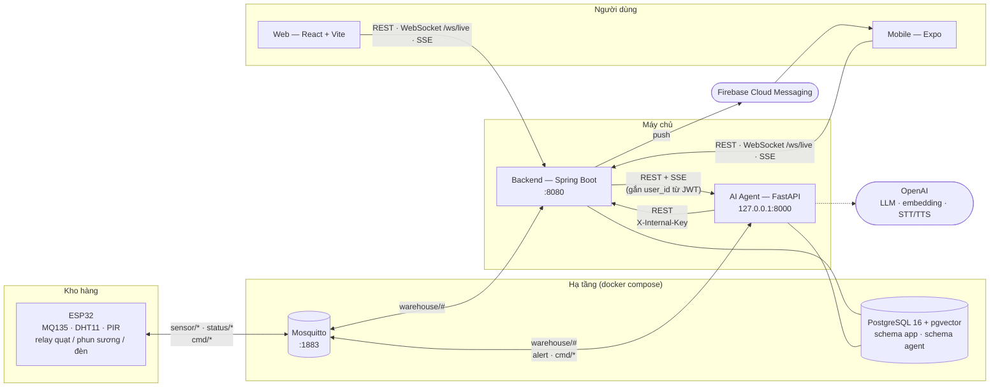
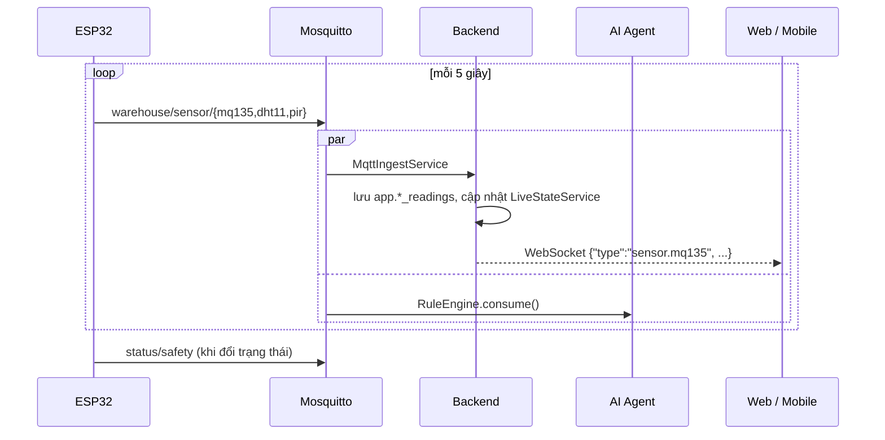
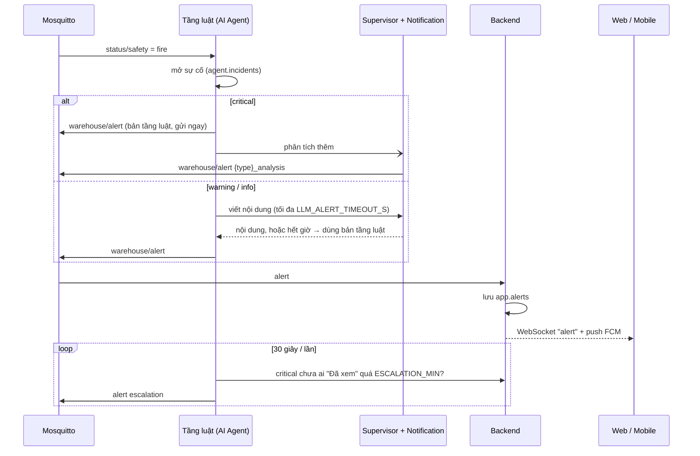
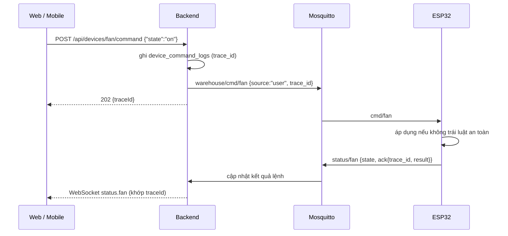
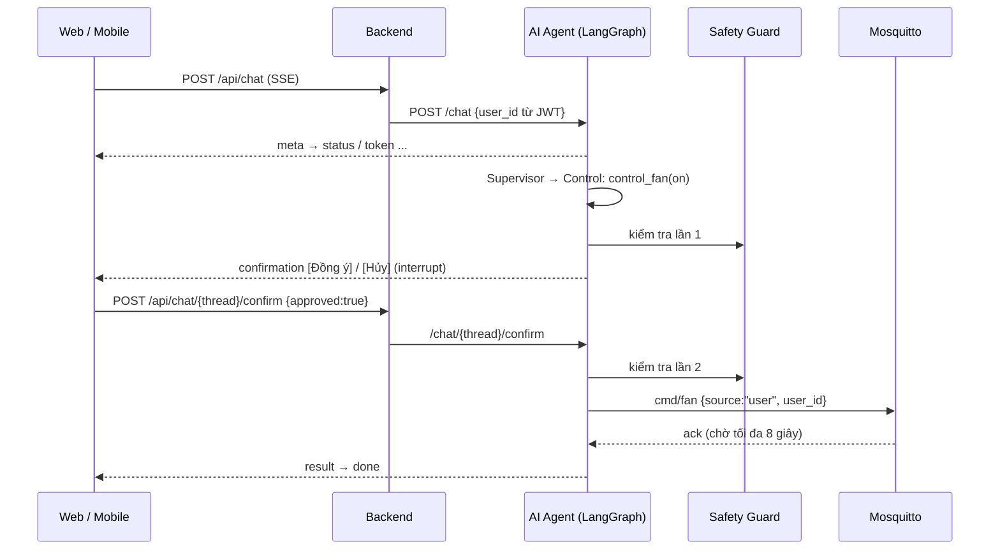
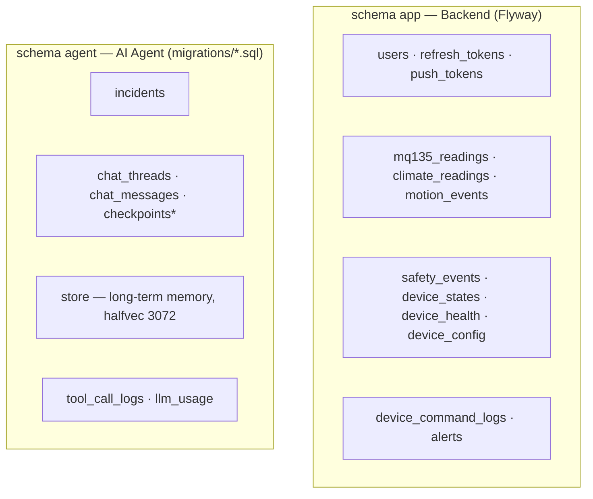

# Kiến trúc hệ thống — Warehouse Guard IoT

Tài liệu này mô tả **cách các thành phần ghép với nhau**: ai nói chuyện với ai, qua giao thức gì, dữ liệu nằm ở đâu và hệ thống xử lý sự cố ra sao. Cách cài đặt, bảng API đầy đủ và hợp đồng MQTT chi tiết nằm ở:

- [README.md](README.md) — tổng quan, hợp đồng MQTT, firmware, cài đặt, ngưỡng
- [backend/README.md](backend/README.md) — REST API, WebSocket, schema `app`
- [ai-agent/README.md](ai-agent/README.md) — tầng luật, multi-agent, memory, API nội bộ, sự kiện SSE
- [frontend/web/README.md](frontend/web/README.md), [frontend/mobile/README.md](frontend/mobile/README.md)

---

## 1. Tổng quan

| Thành phần | Vai trò | Trạng thái do nó sở hữu |
|------------|---------|-------------------------|
| **ESP32** | Đọc cảm biến, chạy logic an toàn tại chỗ, đóng / ngắt relay | Ngưỡng (lưu flash `Preferences`), trạng thái an toàn, chế độ từng thiết bị |
| **Mosquitto** | Bus sự kiện duy nhất giữa thiết bị và server | Bản tin retained (`status/online`, `cmd/config`) |
| **Backend** | Cửa ngõ duy nhất cho người dùng: xác thực, lưu dữ liệu, API, realtime, push, trung gian tới AI Agent | Schema `app`: người dùng, số liệu cảm biến, nhật ký lệnh, cảnh báo, token push |
| **AI Agent** | Tầng luật phát cảnh báo + trợ lý AI (chat, giọng nói, memory) | Schema `agent`: sự cố, hội thoại, checkpoint LangGraph, long-term memory, nhật ký tool, token LLM |
| **Web / Mobile** | Dashboard, điều khiển, cảnh báo, thống kê, chat | Không có (chỉ token đăng nhập và cài đặt cục bộ) |

---

## 2. Nguyên tắc thiết kế

1. **Kho vẫn an toàn khi mất mạng.** Toàn bộ logic phản ứng khẩn cấp (khí, cháy → quạt / phun sương / đèn) chạy trên ESP32. Server chỉ thêm cảnh báo, lưu trữ, thống kê và AI.
2. **Cảnh báo không phụ thuộc LLM.** Tầng luật của AI Agent là code thuần. OpenAI lỗi, chậm hay thiếu khóa thì cảnh báo vẫn đi, chỉ là bản cơ bản. Cảnh báo `critical` không bao giờ bị chặn hay hạ mức.
3. **Mọi lệnh ghi do AI đề xuất đều cần người bấm [Đồng ý]**, và Safety Guard kiểm tra hai lần: lúc tạo đề xuất và ngay trước khi gửi MQTT.
4. **Tách quyền theo service.** Mỗi service có tài khoản MQTT và PostgreSQL riêng. Backend chỉ thấy schema `app`, AI Agent chỉ thấy schema `agent`; dữ liệu qua lại bằng REST.
5. **Một cửa cho client.** Web / mobile chỉ gọi Backend. AI Agent chỉ nghe trên `127.0.0.1`, nên mọi yêu cầu tới nó đều đi qua Backend, nơi gắn `user_id` lấy từ JWT.
6. **Thứ tự ưu tiên lệnh trên ESP32:** an toàn (cháy / khí nguy hiểm) > người dùng (`user`) > tầng luật (`rule`) / AI (`agent`) > tự động.

---

## 3. Các luồng chính

### 3.1 Số liệu cảm biến → màn hình

- Client mới kết nối `/ws/live` nhận ngay một `snapshot` (giống `GET /api/state`), sau đó là từng bản tin.
- `safety_events` và `device_states` chỉ ghi khi giá trị thay đổi. Bản tin retained gửi lại khi kết nối lại broker không tạo dòng trùng.

### 3.2 Phát hiện sự cố → cảnh báo → push

Trong [ai-agent/app/runtime.py](ai-agent/app/runtime.py), tầng luật chạy ba vòng lặp song song: `consume()` xử lý từng bản tin MQTT, `ticker()` chạy nhịp 1 giây cho các luật theo thời gian (xác nhận khí, mất dữ liệu, lệnh không có `ack`), `escalator()` 30 giây hỏi Backend một lần để leo thang. Logic quyết định nằm ở [rules/engine.py](ai-agent/app/rules/engine.py) dưới dạng hàm thuần, nên test được bằng đồng hồ giả.

### 3.3 Điều khiển thiết bị từ giao diện

`trace_id` đi xuyên suốt từ API → MQTT → `ack` của ESP32 → nhật ký, nên tra được một lệnh qua mọi tầng.

### 3.4 Chatbot có xác nhận

Đồ thị LangGraph gồm `supervisor → dispatch → confirm`, một Supervisor và 4 worker:

| Worker | Việc | Quyền |
|--------|------|-------|
| Monitor | Đọc trạng thái, lịch sử, thống kê qua REST của Backend | đọc |
| Analyst | Tìm theo ngữ nghĩa trong long-term memory (sự cố, kiến thức kho, phản hồi) | đọc |
| Control | Đề xuất bật / tắt thiết bị, đổi ngưỡng, hẹn giờ / nối chuỗi lệnh | ghi (cần xác nhận) |
| Notification | Phát thông báo thủ công | ghi (cần xác nhận) |

Mỗi worker chỉ được gắn đúng bộ tool của mình. Mọi tool call đều được ghi vào `agent.tool_call_logs` theo `trace_id`. Lệnh hẹn giờ nằm trong RAM ([agents/scheduler.py](ai-agent/app/agents/scheduler.py)), đến giờ chạy thì Safety Guard kiểm tra lại, và bị hủy nếu người dùng ra lệnh tay mới cho cùng thiết bị hoặc AI Agent khởi động lại.

### 3.5 Đổi ngưỡng

`PUT /api/config`, chatbot (có xác nhận) hoặc `tools/push_config.py` → `warehouse/cmd/config` → ESP32 kiểm tra hợp lệ, lưu flash → trả `status/config`. Backend, Safety Guard và firmware dùng **cùng bộ giới hạn** để một giá trị bị từ chối ở đâu cũng bị từ chối ở mọi nơi.

---

## 4. Dữ liệu

| Schema | Tài khoản | Migration | Ghi chú |
|--------|-----------|-----------|---------|
| `app` | `backend` | Flyway, [backend/src/main/resources/db/migration](backend/src/main/resources/db/migration) | Nguồn sự thật cho số liệu, cảnh báo, người dùng |
| `agent` | `agent` | [ai-agent/migrations](ai-agent/migrations) chạy khi khởi động | Không đọc được `app`; cần dữ liệu thì gọi REST Backend |

Long-term memory chia theo namespace: `users/<id>/profile` (riêng từng người), `warehouse/facts`, `warehouse/incidents`, `warehouse/feedback` (dùng chung). Memory chỉ được thêm ngữ cảnh ("Có thể do …"), **không bao giờ** được dùng để chặn hay hạ mức cảnh báo.

Tài khoản, schema và extension `vector` được tạo lần đầu bởi [postgres/init/01-init.sh](postgres/init/01-init.sh).

---

## 5. Bảo mật và ranh giới mạng

| Cổng | Mở ra | Xác thực |
|------|-------|----------|
| Mosquitto `:1883` | LAN (cho ESP32) | Bắt buộc user / password, mỗi service một tài khoản |
| Backend `:8080` | LAN | JWT HS256 (access 60 phút, refresh xoay vòng 30 ngày) cho người dùng; `X-Internal-Key` cho AI Agent |
| AI Agent `:8000` | `127.0.0.1` | `X-Internal-Key`, chỉ Backend gọi |
| PostgreSQL `:5432`, pgAdmin `:5050`, MQTT WebSocket `:9001` | `127.0.0.1` | Mật khẩu |

- Khóa nội bộ đọc được mọi API của Backend nhưng **không** gọi được API cần người dùng (điều khiển, ack, chat). Vì thế lệnh do AI gửi luôn mang `user_id` của người đã bấm [Đồng ý].
- Bí mật (`.env`, `secrets.h`, `passwd`, service account Firebase) không commit. Log và trace Langfuse được che bí mật trước khi gửi.

---

## 6. Chịu lỗi

| Sự cố | Hệ thống phản ứng |
|-------|-------------------|
| Mất WiFi / broker | ESP32 tiếp tục tự bảo vệ kho; LWT `status/online = offline` → tầng luật cảnh báo `device_offline` |
| ESP32 không gửi số liệu > `OFFLINE_TIMEOUT_S` | Cảnh báo `no_data` |
| Lệnh không có `ack` sau `CMD_ACK_TIMEOUT_S` | Cảnh báo `device_no_response` |
| OpenAI lỗi / chậm / thiếu khóa | Tầng luật gửi bản cơ bản; chatbot trả 503 `llm_disabled` |
| AI Agent tắt | Backend trả 503 `agent_unavailable` cho chat; dashboard, điều khiển tay và lưu dữ liệu vẫn chạy (nhưng không có cảnh báo mới từ tầng luật) |
| Broker / DB chưa sẵn sàng khi khởi động | Backend và AI Agent vẫn chạy, tự kết nối lại |
| FCM lỗi | Push chạy nền, không ảnh hưởng việc lưu cảnh báo; token `UNREGISTERED` tự xóa |
| Langfuse lỗi | Bỏ qua, không ảnh hưởng luồng chính |

---

## 7. Bản đồ code

| Muốn hiểu… | Bắt đầu đọc |
|------------|-------------|
| Logic an toàn trên board | [firmware/warehouse_monitor/logic.h](firmware/warehouse_monitor/logic.h), GPIO và mặc định ở [config.h](firmware/warehouse_monitor/config.h) |
| Backend nhận MQTT và đẩy realtime | [mqtt/MqttIngestService.java](backend/src/main/java/com/warehouse/backend/mqtt/MqttIngestService.java) → [telemetry/LiveStateService.java](backend/src/main/java/com/warehouse/backend/telemetry/LiveStateService.java) → [ws/LiveBroadcaster.java](backend/src/main/java/com/warehouse/backend/ws/LiveBroadcaster.java) |
| Danh sách topic | [mqtt/Topics.java](backend/src/main/java/com/warehouse/backend/mqtt/Topics.java) |
| Xác thực | [security/SecurityConfig.java](backend/src/main/java/com/warehouse/backend/security/SecurityConfig.java), [JwtService.java](backend/src/main/java/com/warehouse/backend/security/JwtService.java), [InternalApiKeyFilter.java](backend/src/main/java/com/warehouse/backend/security/InternalApiKeyFilter.java) |
| Backend trung gian tới AI | [chat/AgentClient.java](backend/src/main/java/com/warehouse/backend/chat/AgentClient.java), [chat/ChatController.java](backend/src/main/java/com/warehouse/backend/chat/ChatController.java) |
| Tầng luật | [ai-agent/app/runtime.py](ai-agent/app/runtime.py) → [rules/engine.py](ai-agent/app/rules/engine.py) → [rules/alert_policy.py](ai-agent/app/rules/alert_policy.py) |
| Đồ thị multi-agent | [agents/graph.py](ai-agent/app/agents/graph.py), [agents/tools.py](ai-agent/app/agents/tools.py), [agents/service.py](ai-agent/app/agents/service.py) |
| Chính sách an toàn của AI | [agents/safety_guard.py](ai-agent/app/agents/safety_guard.py) |
| Memory | [memory/store.py](ai-agent/app/memory/store.py), [memory/extractor.py](ai-agent/app/memory/extractor.py) |
| Kiểu dữ liệu dùng chung web / mobile | [frontend/shared/types.ts](frontend/shared/types.ts), parser SSE ở [frontend/shared/sse.ts](frontend/shared/sse.ts) |
| Chạy thử không cần board | [tools/simulate_esp32.py](tools/simulate_esp32.py) |
